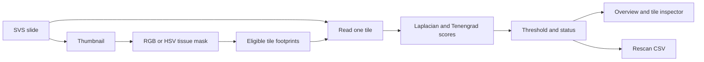

# Understand the project

SlideQC asks one question: **which tissue tiles have low focus scores and might
need another look?** It reads a real slide, filters background, scores tissue,
and exports suggested rescan rectangles. The scanner itself is not controlled.

Start with this guide, follow the reading order, then use the
[interview guide](interview_guide.md) to practise explaining the decisions.

## The pipeline in one picture



The benchmark is a separate experiment: it makes blurred copies of selected
original crops, calibrates thresholds, then evaluates them on another slide.

## Read the files in this order

Paths below are relative to the repository root. Core Python files live in
`src/slideqc/`; they do not depend on Streamlit.

| Order | File | What to understand |
|---|---|---|
| 1 | `segmentation.py` | An RGB image becomes a Boolean tissue mask |
| 2 | `focus.py` | An RGB tile and valid-pixel mask become two raw focus scores |
| 3 | `coordinates.py` | Tile footprints and thumbnail positions refer to level 0 |
| 4 | `slide_io.py` | OpenSlide supplies metadata, thumbnails and small tile reads |
| 5 | `analysis.py` | One loop combines the earlier functions and records statuses |
| 6 | `cli.py` | The pipeline runs without a browser and saves its outputs |
| 7 | `ui/dashboard.py`, `ui/sidebar.py`, `ui/panels.py` | Streamlit collects settings and presents the same results |
| 8 | `benchmark.py`, `evaluation.py` | Focus experiments and human-mask evaluation |
| 9 | `tests/` | Generated examples check coordinates, scores, errors and UI state |

Other useful files: `calibration.py` checks whether saved thresholds suit current
settings; `rendering.py` draws the mask and status overlay; `app.py` launches the
dashboard. `scripts/` holds data fetching and optional browser checks.

## Follow one real tile

Consider CMU-1-Small-Region at analysis level 0, tile size 256:

1. `Slide` reports dimensions **2220 × 2967** and returns a thumbnail of
   **898 × 1200**. Only this small image is used to estimate tissue.
2. `segment_tissue()` marks likely stained pixels. `iter_tiles()` yields tile
   `r00003_c00004`, whose level-0 rectangle is **(1024, 768, 256, 256)**.
3. `tissue_fraction()` estimates how much of that footprint contains tissue.
   Tiles below the configured minimum are recorded as background and not read.
4. `read_tile()` reads just that region. The thumbnail tissue mask is mapped
   onto the read pixels, and transparent pixels are excluded.
5. `focus_scores()` removes pixels next to mask or tile boundaries before
   measuring derivative energy. Both scores use the same supported pixels.
6. `analysis.py` compares the chosen raw score with its threshold and records
   a status and reason. A lower score is only a candidate for review.
7. Clicking the overview reads the same rectangle for the inspector. If flagged,
   the CSV keeps **x=1024, y=768, width=256, height=256** in level-0 pixels.

## The coordinate detail worth explaining

Level 0 is the largest image. Every exported rectangle uses that coordinate
system, even when analysis reads a smaller pyramid level.

For the example above, the tile's thumbnail top-left is:

```text
x_thumbnail = 1024 × 898 / 2220 = 414.21
y_thumbnail =  768 × 1200 / 2967 = 310.62
```

Width and height are scaled separately because thumbnail resizing rounds image
dimensions. A single assumed scale can shift an overlay away from its crop.
Coordinates are kept as floats for click testing; drawing rounds outward.
Rectangles are half-open: `[x, x + width)` excludes the right boundary, so a
point on a shared tile edge belongs to only one tile.

## Small vocabulary list

| Term | Meaning here |
|---|---|
| Whole-slide image | A microscopy image too large to treat like an ordinary photo |
| Pyramid level | A stored lower-resolution version of the same slide |
| Downsample | How many level-0 pixels approximately span one analysis pixel |
| Tissue mask | A same-sized grid of `True` tissue / `False` background estimates |
| Tile footprint | The rectangle a tile occupies in the original slide |
| Morphology | Mask cleanup: opening removes small spots, closing fills small gaps |
| Calibration | Selecting a threshold using one set of examples |
| Held-out evaluation | Checking that threshold on examples not used to select it |

## Keep the three responsibilities separate

**Core analysis** answers what happens to a slide and a configuration. It returns
the thumbnail, tissue mask, tile records and summary. Its small generated test
fixtures make it possible to debug without downloading slides.

**UI** answers how a person chooses settings and inspects results. It uses cached
analysis and can reclassify existing scores when the metric or threshold changes.
The overview, dropdown and table share one selected tile.

**Experiments** answer whether a metric reacts to injected blur and whether a
calibrated threshold transfers. An original and all its blurred variants remain
in one split. Human tissue masks, if supplied, enable a separate IoU/Dice check.

## What to learn before presenting

Be able to trace `analyze_slide()` once, explain why background is skipped, draw
the coordinate conversion on paper, and explain one failure case. Then run the
CLI and the fixture tests using the commands in the [README](../../README.md).
The measured results demonstrate this engineering workflow. Human segmentation
labels and real scanner-defocus labels are still needed for stronger validation.
